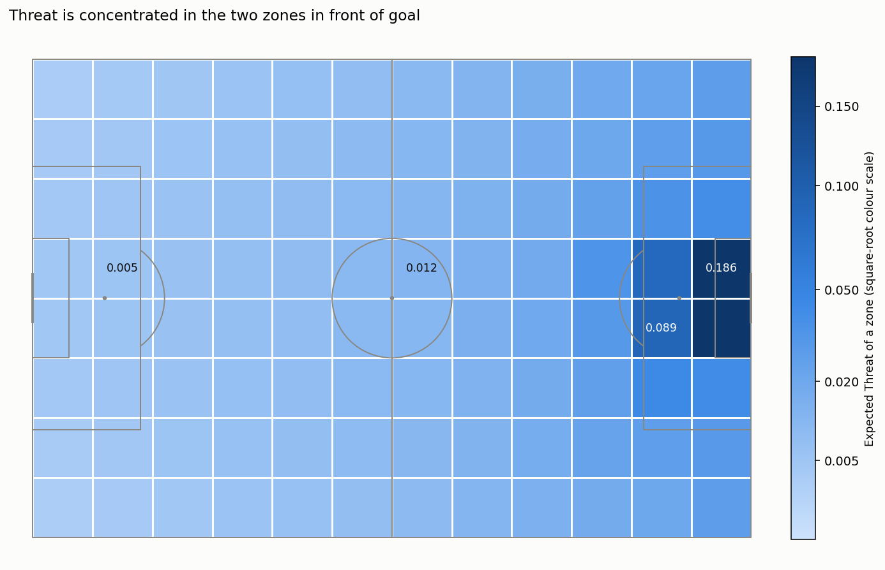
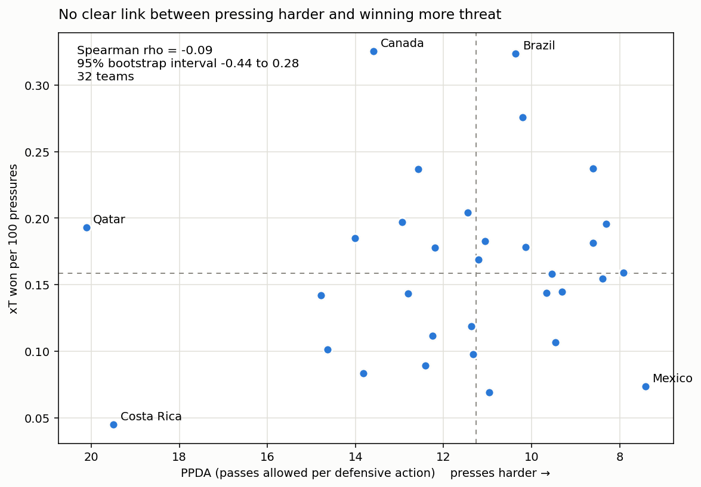
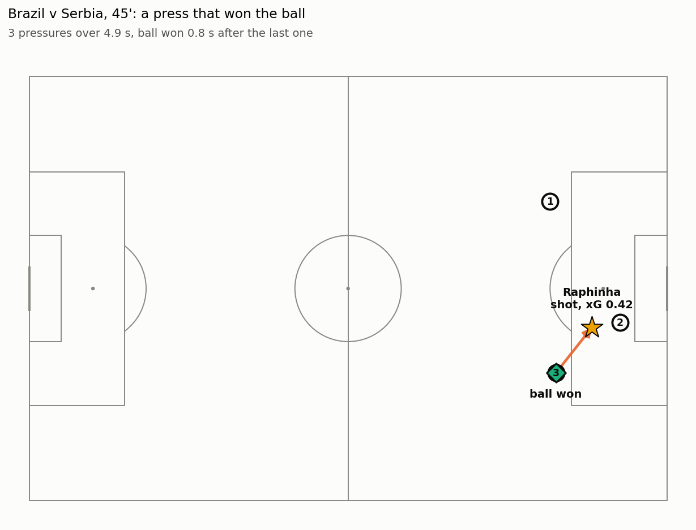

# xT & Pressing

Expected Threat and pressing analysis built from scratch on StatsBomb open data.

> **Status:** work in progress. Part I (Expected Threat, action rating, minutes played),
> Part II (pressing sequences, PPDA, the xT value of what a press wins) and Part III
> (player-level press resistance) are implemented and validated; the figures
> (`xtpress/viz.py`) are still to do.

## Contents

1. [The finding](#the-finding)
2. [Why it matters](#why-it-matters)
3. [How it is measured](#how-it-is-measured)
   - [Expected Threat](#expected-threat)
   - [Pressing](#pressing)
   - [Press resistance](#press-resistance)
4. [Pressing results](#pressing-results)
5. [Press resistance results](#press-resistance-results)
6. [Supporting evidence](#supporting-evidence)
7. [Validation](#validation)
8. [Model decisions](#model-decisions)
   - [Expected Threat decisions](#expected-threat-decisions)
   - [Pressing decisions](#pressing-decisions)
   - [Press resistance decisions](#press-resistance-decisions)
9. [Limitations](#limitations)
10. [What the checks turned up](#what-the-checks-turned-up)
11. [Reproducing it](#reproducing-it)
    - [Where the numbers come from](#where-the-numbers-come-from)
12. [Data](#data)
13. [Repo](#repo)

---

## The finding

How hard a team presses says little about what the pressing earns. Across the 32 teams
at WC 2022, PPDA and the expected threat won per 100 pressures show no detectable
relationship (Spearman ρ = −0.09, 95% bootstrap interval −0.44 to 0.28): Mexico pressed
hardest (PPDA 7.4) and earned 0.073, while Brazil pressed at a middling 10.4 and earned
0.324.

At player level the same caution applies, more strongly. Pressured, a player keeps the ball
80.1% of the time (89.0% when not pressured), and once that is adjusted for the zone the
ball was received in, the 179 players with at least 50 pressured actions run from −15.8 to
+12.0 percentage points around expectation. But most of that spread is sampling noise: a
typical player has about 74 pressured actions, which alone gives a standard error of
4.6 points against an observed spread of 5.4, and ranking the players on odd and even
matches separately gives a rank correlation of only 0.26 for retention and 0.32 for threat.
The leaderboard describes this tournament; it is not a measure of a stable skill.

*Provisional: the headline is still the pressing one and has not been rewritten around
Part III. The figure for press resistance, `figures/press_resistance.png`, is not
generated yet.*

## Why it matters

PPDA quantifies how much a team presses the opponents, more specifically how many passes are allowed before engaging defensively. The measure here prices what the press wins, in the same units as every pass and carry in the model. Where the ball is won matters: the zone where it is won is worth 0.0142 xT for a high regain against 0.0066 for the rest, and 15.9% of high regains reach a shot against 10.4% of all wins. So the useful question for a coach or an analyst is not how much a team presses, but what it does once the ball is won, and where.

## How it is measured

### Expected Threat

The pitch is split into a 12×8 grid. Each zone's value is the probability that a possession starting there ends in a goal, found by treating play as a Markov chain: from each zone the ball is shot, moved to another zone, or lost, using the frequencies observed in WC 2022. The xT of a pass or carry is the value of where it ends minus where it started. See [`xtpress/expected_threat.py`](xtpress/expected_threat.py).

### Pressing

Pressure events are grouped into sequences: within a team and match, a new sequence starts after a 5 s gap, a change of possession, or a new period. A sequence succeeds if the next possession belongs to the pressing team and starts within 8 s of the last pressure, and it is "high" if the ball is won in the opponent's half. The xT of everything that possession went on to produce is added up from the same rated actions as Part I, so pressing is priced in the same units as every pass and carry, and each won possession is credited once. Intensity is reported two ways: PPDA, and pressures per opponent-half touch. See[`xtpress/pressing_sequences.py`](xtpress/pressing_sequences.py).

### Press resistance

A pressured action is a pass, carry, dribble, dispossession or miscontrol that StatsBomb flags `under_pressure`. For each player the measure has two axes: whether the ball survives (retention), and whether it goes somewhere useful when it does (the xT of the retained passes and carries). Both are compared with the league average for the zone the action started in, so the figure is "above expected" rather than a raw ratio: a centre-back pressured on his own six-yard line and a winger pressured in the final third are not doing the same job. Players need at least 50 pressured actions. The two axes are the result; a single score (the two standardised and weighted 50/50) exists only to sort the table. See [`xtpress/press_resistance.py`](xtpress/press_resistance.py).

## Pressing results

WC 2022, 32 teams, pooled over every match each team played. A selection from the ends of the payoff ranking:

**Table 1**

*Pressing intensity and payoff for the three best and three worst of 32 teams on xT won per 100 pressures, WC 2022*

| Team        | Matches | PPDA | Regain rate | xT per 100 pressures | Shots from presses |
| ----------- | ------- | ---- | ----------- | -------------------- | ------------------ |
| Canada      | 3       | 13.6 | 16.4%       | 0.325                | 10                 |
| Brazil      | 5       | 10.4 | 21.2%       | 0.324                | 13                 |
| Germany     | 3       | 10.2 | 20.0%       | 0.276                | 11                 |
| Mexico      | 3       | 7.4  | 15.9%       | 0.073                | 2                  |
| South Korea | 4       | 11.0 | 14.2%       | 0.069                | 2                  |
| Costa Rica  | 3       | 19.5 | 14.4%       | 0.045                | 0                  |

*Note.* PPDA is passes allowed per defensive action, so lower means more pressing. Regain rate is the share of all pressing sequences after which the pressing team won the ball within 8 s. Reproduce with `python -m xtpress.report table_1` (`report.table_1`), from `data/processed/actions_43_106.parquet` and `data/raw/`. Pinned by `test_table_1_pressing_results`.

Across all 32 teams the median PPDA is 11.3 and the median payoff is 0.159 xT per 100 pressures. Most teams played only three matches, so a team's total is built from very few shots (0 to 15): read the ends of the table as examples, not as rankings.

When a press wins the ball it does so quickly and deep: the median time from the last pressure to the regain is 2.5 s (41% within 2 s, 90% within 6.8 s), and the median regain is at x = 37, with 54% in the team's own third and only 5% in the final third. The PPDA–payoff correlation stays between −0.05 and −0.23 for every regain window from 2 to 15 s.

## Press resistance results

WC 2022, 64 matches. 25,270 of the 128,711 actions (19.6%) were taken under pressure. Pressured, 80.1% of them kept the ball, against 89.0% of the same event types when not pressured. Of the pressured actions 27.2% retained the ball and raised its xT, 49.2% retained it without raising it, 3.7% were successful dribbles and 19.9% lost it.

Pass completion falls from 83.7% to 70.8% under pressure. Carries are never recorded as failed, so the other losses show up as 1,869 dispossessions and miscontrols, plus 856 failed dribbles (a dribble is always flagged as pressured). 179 of the 663 players who were ever pressured have at least 50 pressured actions. A selection from the ends of the combined score, with each player's retention and xT compared with the league average for the zones they received in:

**Table 2**

*Press resistance of the five highest and three lowest of 179 players on the combined score, WC 2022*

| Player         | Position | Pressured actions | Retention | vs expected | xT vs expected | Score  |
| -------------- | -------- | ----------------- | --------- | ----------- | -------------- | ------ |
| Hirving Lozano | FW       | 72                | 79.2%     | +2.6 pts    | +0.0051        | 1.82   |
| Aziz Behich    | DF       | 78                | 79.5%     | +2.4 pts    | +0.0049        | 1.72   |
| Rafael Leão   | FW       | 50                | 80.0%     | +2.5 pts    | +0.0047        | 1.66   |
| Phil Foden     | FW       | 73                | 90.4%     | +10.8 pts   | +0.0017        | 1.46   |
| Lionel Messi   | FW       | 352               | 85.5%     | +6.3 pts    | +0.0020        | 1.16   |
| Mathew Leckie  | MF       | 111               | 66.7%     | −11.6 pts  | −0.0005       | −1.33 |
| Richarlison    | FW       | 71                | 73.2%     | −3.4 pts   | −0.0031       | −1.40 |
| Gue-Sung Cho   | FW       | 62                | 66.1%     | −10.6 pts  | −0.0049       | −2.65 |

*Note.* Pressured actions are passes, carries, dribbles, dispossessions and miscontrols flagged `under_pressure`; every player has at least 50. Retention and xT per retained move are differences from the league average for the zones the player received the ball in. Score is the 50/50 blend of the two standardised differences (`press_resistance_score`). Reproduce with `python -m xtpress.report table_2` (`report.table_2`); the weight sensitivity quoted below it is `weights` (`report.score_weights`). Pinned by `test_table_2_leaderboard` and `test_score_weights`.

The two axes are mildly opposed (Spearman −0.18 between them): the players who keep the ball most reliably are mostly not the ones who move it furthest, which is why the score depends on the weights. At 70/30 only 5 of the 10 best at 50/50 stay in the top 10, and at 30/70, 7. The three best by retention alone are Steven Bergwijn, Salis Abdul Samed and the goalkeeper Unai Simón, none of them in the combined top 10.

**Table 3**

*Retention under pressure by position group, outfield players with at least 50 pressured actions, WC 2022*

| Position group | Players | Mean retention | Mean retention vs expected |
| -------------- | ------- | -------------- | -------------------------- |
| DF             | 40      | 81.7%          | +1.2 pts                   |
| MF             | 71      | 83.0%          | +2.1 pts                   |
| FW             | 66      | 77.6%          | −0.9 pts                  |

*Note.* Means over players, not over actions. The 2 goalkeepers who reach 50 actions are left out (Table 4). Reproduce with `python -m xtpress.report table_3` (`report.table_3`). The differences, standard errors and dribble and loss shares in the text are `groups` (`report.position_group_tests`); the standard errors treat each player's figure as one observation. Pinned by `test_table_3_position_groups` and `test_position_group_text`.

Outfield players only; goalkeepers are described separately below. Forwards keep the ball least, and the gap survives the zone adjustment. They are 2.9 points below midfielders (about 3.3 standard errors, taking each player's figure as one observation) and 2.1 below defenders (1.8 standard errors); midfielders and defenders cannot be told apart (0.9 points, 0.9 standard errors). Part of it is the dribble: 10.6% of forwards' pressured actions are dribbles, against 5.6% for defenders and 6.9% for midfielders, and a dribble succeeds only about half the time. They are also dispossessed or miscontrol the ball more often (10.3% of their pressured actions, against about 6% for the others). But it is not all the dribble: without dribbles forwards still keep the ball less (81.0% against 85.7% for midfielders), and so they do on passes alone (70.6% against 77.5%; all pooled over actions). A tactical reading is plausible, that wide forwards are used for 1v1s and that few play as deep-lying forwards or false nines, while defenders and midfielders take the ball in build-up. It is a hypothesis: nothing here measures the roles or the build-up, only that forwards dribble more and lose the ball more.

**Goalkeepers (descriptive only, threshold 25).** Only 2 goalkeepers reach the 50 pressured actions used everywhere else, so this note takes at least 25, which gives 10 (40 goalkeepers were pressured at all). A threshold of 25 is noisier: the standard error on a goalkeeper's retention is about 6 points at the median of 38 actions, and the spread among the ten is 9.9 points, about 1.6 standard errors. It is not a ranking.

**Table 4**

*Goalkeepers with at least 25 pressured actions, WC 2022 (descriptive only)*

| Goalkeeper         | Pressured actions | Retention | vs expected |
| ------------------ | ----------------- | --------- | ----------- |
| Yassine Bounou     | 59                | 84.7%     | +1.0 pts    |
| Unai Simón        | 55                | 96.4%     | +11.7 pts   |
| Emiliano Martínez | 49                | 77.6%     | −5.5 pts   |
| Mathew Ryan        | 47                | 83.0%     | −0.2 pts   |
| Diogo Costa        | 39                | 74.4%     | −10.2 pts  |
| Dominik Livaković | 38                | 76.3%     | −8.1 pts   |
| Jordan Pickford    | 29                | 75.9%     | −6.5 pts   |
| Yann Sommer        | 29                | 93.1%     | +8.3 pts    |
| Andries Noppert    | 27                | 66.7%     | −17.3 pts  |
| Hugo Lloris        | 26                | 65.4%     | −18.3 pts  |

*Note.* The threshold is 25, lower than the 50 used elsewhere, so each figure is noisier. "vs expected" uses the zone baselines of all players, goalkeepers included (see text). Reproduce with `python -m xtpress.report table_4` (`report.table_4`); the figures in the text are `gk` (`report.goalkeeper_note`). Pinned by `test_table_4_goalkeepers` and `test_goalkeeper_note`.

Pooled over all 40 goalkeepers, 760 pressured actions are 81.3% retained (56% of them carries). The "vs expected" column needs care: it uses the same zone baselines as outfield players, 93% of goalkeepers' pressured actions start within 18 yards of their own goal, and in that strip goalkeepers are 41% of the baseline's actions. The expectation there is a blend of goalkeepers and defenders, and the ten average −4.5 points, which largely reflects goalkeepers keeping the ball a little less than outfield players do in the same zones (81.3% against 84.3%, pooled). The threat axis is not shown: for all ten it lies between −0.0002 and +0.0006, against a standard deviation of 0.0017 among outfield players, so it separates nobody.

## Supporting evidence

| Figure                            | What it shows                                          |
| --------------------------------- | ------------------------------------------------------ |
|        | The fitted value surface.                              |
|     | Pressing intensity against pressing payoff.            |
|        | One sequence: the press, the turnover, what followed.  |
|  | Players: retention against threat, both zone-adjusted. |

*Figure 1.* The fitted value surface. *Note.* The grid is `report.build_context().model.grid()`; drawn by `viz.plot_xt_surface` (not implemented yet).

*Figure 2.* Pressing intensity against pressing payoff, one point per team. *Note.* Data: `report.build_context().summary`; drawn by `viz.plot_team_pressing` (not implemented yet). The correlation and its interval are `report.bootstrap_spearman` (4,000 resamples, seed 0).

*Figure 3.* One pressing sequence: the press, the turnover, what followed. *Note.* Data: one row of `report.build_context().sequences` with its pressures and the possession it won; drawn by `viz.plot_case_study` (not implemented yet).

*Figure 4.* Players: retention against threat, both adjusted for the zone. *Note.* Data: `report.build_context().players`; drawn by `viz.plot_press_resistance_quadrant` (not implemented yet).

*The figures are generated by `xtpress/viz.py` and exported to `figures/`, which is tracked in git (unlike `data/raw` and `data/processed`) so the images render on GitHub. They are not generated yet, so the links do not resolve. Add one line of interpretation under each when they are.*

## Validation

**Table 5**

*Validation checks: target set for each and the result on WC 2022*

| Check                                                 | Target                         | Result                                                                                                                                       |
| ----------------------------------------------------- | ------------------------------ | -------------------------------------------------------------------------------------------------------------------------------------------- |
| Iterative vs closed-form solve                        | agree to 1e-9                  | 7.0e-12 (173 iterations)                                                                                                                     |
| Correlation with Karun Singh's published 12×8 grid   | r > 0.97                       | 0.996 (MAE 0.0077)                                                                                                                           |
| Same, without the completion factor (baseline)        | r > 0.97                       | 0.860 - fails; see below                                                                                                                     |
| Transition matrix rows sum to 1                       | within 1e-9                    | 2.2e-16                                                                                                                                      |
| Pass completion rate                                  | 0.78–0.84                     | 0.822                                                                                                                                        |
| PPDA across teams                                     | 6–15                          | 7.4–20.1 across 32 teams (30 inside, median 11.3); 77% of 128 team-matches inside 6–15                                                     |
| Press-to-regain rate                                  | 13–21% (6–12 s windows)      | 16.3% at the default 8 s window (13.7% at 6 s, 20.6% at 12 s); 19.1% at 8 s excluding sequences in the team's own possession                 |
| High regains (ball won at x ≥ 60)                    | none                           | 3.5% of sequences (5.6% at x ≥ 50, 1.9% at x ≥ 70)                                                                                         |
| xT earned per won possession                          | 0.01–0.03                     | 0.0139                                                                                                                                       |
| Won possessions that reach a shot                     | 10–20%                        | 10.4%                                                                                                                                        |
| Pressures per opponent-half touch                     | none                           | median 0.075 per team-match (0.027–0.159); 45% of all pressures are in the opponent's half                                                  |
| Sequences never span a possession change              | all                            | all (tested)                                                                                                                                 |
| Retention under pressure, league-wide                 | 75–85% (first set at 65–80%) | 80.1% (89.0% unpressured, same event types); 86.5% if dispossessions and miscontrols are left out                                            |
| Pressured share of actions                            | none                           | 19.6% of actions (25,270); about 10% of all events for passes and carries, against the 8–12% in the brief                                   |
| Zone adjustment changes the ranking                   | Spearman < 0.99                | 0.935 between raw and adjusted retention                                                                                                     |
| Zone baselines have enough data                       | none                           | smallest zone 28 actions, median 251; 2 of 96 zones under 50                                                                                 |
| Player metric repeats across halves of the tournament | none                           | Spearman 0.26 (retention) and 0.32 (threat), 65 players with at least 25 actions in both halves (odd vs even matches)                        |
| Team xT vs goals, held out                            | Spearman ρ 0.45–0.65         | 0.30 across 32 teams (95% interval −0.09 to 0.62), 0.25 across 128 team-matches (0.07 to 0.42): below the target. Against xG: 0.54 and 0.56 |

*Note.* All results are WC 2022 (64 matches, 128,711 actions). Sources, by `python -m xtpress.report <section>`: the surface rows (iterative vs closed form, correlation with the published grid, the baseline, transition rows, pass completion) are `expected_threat`; PPDA, press-to-regain at the default window, high regains at x ≥ 60, xT per won possession, shots and pressures per touch are `pressing`; press-to-regain at 6 and 12 s and with own-possession sequences excluded, and the x ≥ 50 and x ≥ 70 lines, are `sensitivity`; retention, pressured share, zone adjustment, zone baselines and split-half stability are `press_resistance`; team xT vs goals is `xt_vs_goals`. "Sequences never span a possession change" is a test (`tests/test_invariants.py`), not a measurement. Pinned by `test_surface_validation_rows`, `test_pressing_validation_rows`, `test_sensitivity_to_the_regain_window`, `test_sensitivity_to_the_gap_and_the_high_line`, `test_press_resistance_overview`, `test_press_resistance_noise_figures` and `test_team_xt_against_goals`. The targets were written by the project scaffold (first commit) and none cites a source; where a target was moved after measuring, the notes below say so.

Measured on WC 2022 (64 matches, 128,711 actions), 12×8 grid, fitted and checked on the same competition. The published grid was fitted on other leagues, so this tests agreement of shape, not accuracy. It is also exactly symmetric top to bottom; this grid is not (4.0% mean asymmetry, and no symmetrisation is applied).

The completion factor was found by checking against the published grid, not derived in advance. The textbook recursion, where the rows of the transition matrix sum to 1 and a failed move simply vanishes, gave r=0.860 and a nearly flat surface (goal-end 1.4x the own-end, against 12.6x in the published grid). The factor has no free parameters - it is each zone's observed completion rate - but I chose it after the mismatch. The baseline is kept (`fit(..., model_loss=False)`) so the comparison can be rerun.

The retention band of 65–80% was set before the data was loaded. The measured 80.1% sits on its upper edge, so the target is now 75–85%, moved after the measurement as with PPDA and press-to-regain. It is only meaningful with losses in: StatsBomb never records a carry as failed, and the ball lost on a carry appears as a separate Dispossessed or Miscontrol event, so a sample of passes, carries and dribbles alone reads 86.5% and looks healthy. The comparison with unpressured play has to use the same event types: 90.2% is passes and carries alone, 89.0% is like for like.

The split-half row is the least comfortable one. Both correlations are positive but low, which is what a metric with a small real signal and large sampling noise looks like; with players limited to 25 actions per half there are also only 65 of them. It does not say the metric is meaningless, only that a player's position on this leaderboard should not be read as a skill ranking.

The PPDA band of 6–15 was first measured on three matches. Over 64 it does not hold for every team: 23% of team-matches fall outside it, at both ends (Japan 26.3 and Morocco 25.2 don't press as high, Ecuador 4.2 was the one that pressed the most).

The press-to-regain reference of about 15–20% was set without a window. It holds only for windows of roughly 8 to 12 s (16.3% to 20.6%); at 6 s it is 13.7%. The target is therefore stated as 13–21% across 6–12 s windows, and the result is always quoted with its window.

The team-level check against goals does not reach the 0.45–0.65 set in advance, and I have not moved the band. "Held out" here means cross-fitting inside WC 2022, the only competition processed: the grid is fitted on the odd-numbered matches and used to rate the even ones, and the reverse, so no match is rated by a grid that saw it. Net xT per match (open play, regulation time) is then set against goals per match. Across the 32 teams the Spearman correlation is 0.30 (bootstrap interval −0.09 to 0.62) and across the 128 team-matches 0.25 (0.07 to 0.42). With 128 observations the interval lies below the band; with 32 it is too wide to say. Fitting in-sample gives the same 0.25, so the cross-fit is not what lowers it. A more likely reason is that goals are rare: 165 in 128 team-matches, 44 of which had none, and goals correlate only 0.54 with the xG of the shots behind them. Against xG, xT does about as well as goals do (0.56 across team-matches, interval 0.41 to 0.68; 0.54 across teams, 0.20 to 0.78). The honest reading is that xT follows chance quality about as closely as goals do and that this sample cannot show more. It is not independent validation: the grid and the matches come from the same tournament. It is computed by `report.team_xt_vs_goals`.

## Model decisions

### Expected Threat decisions

- **Loss is modelled in the surface, not in the rating.** A zone's value is scaled by its observed completion rate (about 90% of moves arrive, from 55% to 95% by zone), so a lost ball ends the chain with value 0. The textbook form is kept as a baseline and reported in Validation.
- Failed actions are excluded from the rating rather than charged `-xt_start`, so the rating measures gain only.
- Negative deltas are kept, so the figure is *net* progression. A clipped-at-zero column is provided alongside.
- Set pieces are flagged and excluded from the headline tables. They are 5.1% of move attempts and still count as moves in the shoot-or-move split, which is a judgement call: a corner is arguably not a decision to move rather than shoot.
- Penalties are excluded from shots (23 in this sample). Every one is struck from the same spot and would make a false hotspot in `g(z)`.
- Scoring probability `g(z)` comes from mean StatsBomb xG per zone, not the raw goal rate. 68 of 96 zones have no shots and get 0, which is harmless because shot probability there is also 0.
- The grid is 12×8 and is not symmetrised.

### Pressing decisions

- **Frames.** StatsBomb records every event in the frame of the team that performed it, so a Pressure and the possession team's action are mirror images. Pressure coordinates are mirrored before they are compared with the possession team's, and `mean_x` of a sequence is kept raw because it answers how high the team pressed.
- **Linking pressures to actions.** 90.5% of pressures name the action they affected in `related_events`. The rest are matched to the nearest action in time (within 2 s, same match, period and opposing team), which agrees with the true link 58% of the time; matching forward only agrees 37%.
- **Sequence gap.** 5 s; a change of possession or period also starts a new sequence. The gap changes the sequence count a lot (2 s gives 14,588 sequences, 12 s gives 10,394) and the regain rate only from 15.7% to 18.9%, and it does not change the team payoff at all: the payoff divides by pressures and credits won possessions, so it does not depend on how pressures are grouped.
- **Success.** The next possession (id + 1) is the pressing team's and starts within 8 s of the last pressure. The recovery event itself is not used, because it is often logged in the old possession. The 8 s window is a real choice: the regain rate is 6.7% at 2 s, 16.3% at 8 s and 23.3% at 15 s. The team ranking by payoff is stable from 4 s upward (rank correlation 0.91 or more against 8 s) but not at 2 s (0.59), where there are too few wins to rank on.
- **High regain.** The ball is won at x ≥ 60, the opponent's half, in the pressing team's own frame. That is 3.5% of sequences (21.5% of wins); if I move the line: 5.6% at x ≥ 50, 1.9% at x ≥ 70 and 0.9% at x ≥ 80.
- **Presses in the team's own possession.** 15% of sequences (1,840 of 12,424) are logged during the pressing team's own possession. They cannot win the ball, so they are never counted as successes, but they stay in the denominators.
- **Counterpress.** 20.1% of pressures are flagged as counterpress, and 21.5% of sequences contain one. Against the opponent's possession they win the ball less often (13.7% against 20.2%) but more often high (5.7% against 3.8%), and what they win is worth less (0.0120 xT against 0.0142).
- **PPDA.** Opponent passes (x ≤ 72, in the opponent’s frame) divided by the team’s own Duels, Interceptions and Fouls Committed (x ≥ 48, in the team’s own frame). Both describe the same strip: the opponent’s own defensive 60%. Aerial duels are included (half of all duels). Pooled across matches, not averaged. Set-piece passes are counted too: 4,130 of the 47,484 passes in the zone are goal kicks (1,002), throw-ins (1,437), free kicks, corners or kick-offs. Leaving them out lowers the median team-match PPDA from 11.7 to 10.5 and leaves the ranking almost unchanged (Spearman 0.998 across team-matches), so the level depends on the definition and the ordering does not. A PPDA taken from elsewhere is comparable with these numbers only if it makes the same choice.
- **Touches.** Pressures per opponent-half touch counts eight on-ball event types, including receipts. The ranking barely changes between definitions (Spearman ≥ 0.988).
- **Credit.** Each won possession is credited once. 6% of won sequences share a possession with another won sequence, and counting both would add 4.9% to the xT and nine shots.

### Press resistance decisions

- **Key off the action, not the receipt.** On one match 236 carries and 100 passes carry `under_pressure` but only 47 ball receipts, so using receipts would throw away about 80% of the sample.
- **Losses are in the sample.** Dispossessed and Miscontrol events are included as lost balls (1,869 of them). Without them retention reads 86.5% instead of 80.1%. Shots (238) are left out: a shot is not a decision to keep the ball.
- **Dribbles get their own outcome.** A dribble has no end location, so it has no xT; a successful one is `retained_dribble` (937, 3.7%), not "progressed" or "flat". Dribbles are excluded from the threat axis and counted in retention.
- **Foul Won is a known gap.** It is not in the action frame. The raw events hold 1,674 pressured Foul Wons (6.6% on top of the sample); counting them as retained would lift retention from 80.1% to 81.3%. Not corrected.
- **Zone is where the action started.** It is where the player had the ball when the pressure arrived, and the only place a dribble has. The baselines use the same 12×8 grid as the xT model and are not smoothed: every zone has data (smallest 28 actions, median 251).
- **The adjustment is modest.** Zone alone explains 2.5% of the variance in whether an action is retained and 8.6% of the xT delta, and the adjusted ranking correlates 0.935 with the raw one. It changes the order but not beyond recognition.
- **The baseline includes the player's own actions.** Leaving them out gives the same ranking (Spearman 0.9999), so it is not corrected.
- **Threat is measured on retained passes and carries only.** A lost ball or a dribble has no xT delta and is skipped rather than counted as zero, so the two axes stay separate: retention says whether the ball survived, threat says whether it went somewhere when it did.
- **At least 50 pressured actions.** That keeps 179 of 663 players. Per 90 minutes uses regulation time only (2.2% of the pressured sample is extra time and is left out of that column only).
- **Position groups.** The 23 StatsBomb position labels are collapsed to GK, DF, MF and FW (anything that does not name a keeper, back or midfielder is FW), by the player's most common label, and percentiles are taken within the group. There are 71 MF, 66 FW, 40 DF and 2 GK, so goalkeepers are left out of the group comparison and described separately (see Press resistance results).
- **Score.** Each adjusted axis is standardised across the 179 players and the two are blended 50/50. Standardising is necessary: retention varies by about 0.054 between players and threat by 0.0015, so an unstandardised blend would be 99.9% retention. The weights are a judgement; 50/50 is the neutral choice, not a finding. The even blend correlates 0.65 with the retention axis and 0.55 with threat.

## Limitations

- The surface models loss but the rating does not. A failed pass lowers the value of the zone it started from, but an individual failed action still scores zero, so xT never charges a player for losing the ball and rewards volume progression. Closing that needs an action-value model such as VAEP.
- Pressure events are a human annotation against a five-yard convention, not ground truth.
- The sample is a single tournament (WC 2022: 64 matches, 128,711 actions); player-level figures carry real uncertainty.
- Most teams played three matches (maximum seven), so team-level pressing figures rest on very few sequences and shots. Among the 16 teams with four or more matches the PPDA-payoff correlation is −0.30, against −0.09 for all 32, which shows how unstable it is at this size.
- Sequences are mostly single presses: 76% contain one pressure and the median lasts 0 s, so "sequence" overstates how much tactical structure there is.
- The payoff is not causal. It is everything the won possession produced, which depends on who won it as well as on the press, so good attacking sides will rate higher.
- PPDA counts the opponent's passes, so a side that plays long over the press looks less pressed. Pressures per opponent-half touch avoids that, but the two agree only partly (Spearman −0.63).
- Most of the spread in the press-resistance table is sampling noise. At the median of 74 pressured actions the binomial standard error on retention is about 4.6 points, against an observed spread of 5.4, and the odd/even-match rank correlation is 0.26 (retention) and 0.32 (threat). A figure for one player is a description of this tournament.
- Press resistance is confounded by who a player is asked to receive against; the zone adjustment reduces this but does not remove it. There is no measure of how hard the pressure was, only that it was flagged.
- Carries never fail in StatsBomb, so a heavy carrier's retention depends on how consistently the dispossessions and miscontrols were logged rather than on a success flag.
- The 50-action threshold leaves out 484 of the 663 players who were ever pressured, so the leaderboard is of players with many pressured touches.
- Two goalkeepers pass the threshold, so goalkeeper percentiles are not meaningful. The separate goalkeeper note uses a threshold of 25 (10 goalkeepers) and is noisier still.
- The combined press-resistance score depends on the 50/50 weighting; at 70/30 or 30/70 the top 10 changes by 3 to 5 of its 10 players.
- Per-zone completion rates rest on as few as 50 attempts in the quietest zones.
- The PPDA–payoff correlation is small at every regain window from 2 to 15 s (−0.05 to −0.23), so the finding is not an artefact of the 8 s choice. The larger uncertainty is the sample: the 95% bootstrap interval over the 32 teams is −0.44 to 0.28 (percentile method, 4,000 resamples of the teams, seed 0; 10,000 resamples give the same to two decimals). It is computed by `report.bootstrap_spearman`.
- Counterpress sequences are pooled with the rest although they behave differently (lower regain rate, higher share won high), so a team that counterpresses a lot is not directly comparable with one that does not.

## What the checks turned up

The main risk in this project was a wrong answer that looks right, so every function has a
hand-counted test, and each test was checked by breaking the code on purpose and confirming
that it fails. A few of the things that came out of it:

- **PPDA is not confined to 6–15.** The band came from three matches; over 64, 23% of team-matches fall outside it and they are real teams.
- **A team makes about 94 pressing sequences per match** (median, range 61–163), not the 40–80 I had been told to expect.
- **Plausible wrong answers are easy.** Using the wrong zone threshold for the opponent's passes gives a median PPDA of 6.7, inside the usual band and wrong. Dividing the payoff by sequences instead of pressures inflates it by a factor of 1.33.
- **Presses overlap.** 6% of won sequences share a won possession with another one, and 15% of all sequences are logged during the pressing team's own possession.
- **The fallback for linking pressures is weaker than it looks.** It matches an action 96% of the time but agrees with the true link only 58% of the time.
- **A case-sensitive match mislabelled 40 defenders.** The first position grouping looked for "back" in lowercase; the labels read "Left Back" and "Center Back", so all 40 defenders came out as forwards and the group counts were quietly wrong. It was found by comparing the group sizes with the position labels.
- **Leaving out the lost balls makes retention look better, not worse.** Counting only passes, carries and dribbles gives 86.5%; with dispossessions and miscontrols it is 80.1%. A first comparison against 90.2% "unpressured" was the wrong population; the like-for-like figure is 89.0%.
- **The leaderboard is mostly noise.** Retention is a binomial rate on about 74 actions; rank stability across odd and even matches is 0.26. The adjustment changes the ranking (0.935 against raw) without making it reliable.
- **The check against goals did not hold its band.** Cross-fitted xT against goals per match gives a Spearman of 0.30 across teams and 0.25 across team-matches, against a target of 0.45–0.65, while against xG it is 0.54–0.56. Goals correlate only 0.54 with the xG of the shots behind them, so the band was probably set for a less noisy target.
- **PPDA depends on whether set-piece passes count.** 8.7% of the passes in the zone are set pieces, including 1,002 goal kicks. Counting them or not moves the median from 10.5 to 11.7 and the ranking not at all (0.998).
- **The window and the gap do not matter equally.** Moving the gap from 2 s to 12 s changes the sequence count by 29% and the team payoff by nothing; moving the regain window from 2 s to 15 s takes the regain rate from 6.7% to 23.3%.

## Reproducing it

Requires Python 3.10+. Developed on 3.14.

```bash
py -m venv .venv
.venv\Scripts\Activate.ps1
pip install -r requirements.txt
pip install -e .
```

```bash
python -m xtpress.loaders --competition wc_2022
```

Run the tests:

```bash
python -m pytest -q
```

Tests that need the full competition skip themselves until the data above has been built.

The pressing pipeline end to end, for the whole competition (about a minute, mostly fitting the model):

```python
import pandas as pd
from xtpress import config, loaders
from xtpress.expected_threat import ExpectedThreat
from xtpress.pressing_sequences import *

actions = loaders.load_actions([config.FOCUS_COMPETITION])
rated = ExpectedThreat(cols=config.GRID_COLS, rows=config.GRID_ROWS).fit(actions).rate_actions(actions)
events = pd.concat([loaders.load_events(m) for m in sorted(actions.match_id.unique())], ignore_index=True)

sequences = build_press_sequences(extract_pressures(events))
sequences = label_sequence_outcomes(sequences, events)
sequences = sequence_value(sequences, rated, actions)
summary = team_pressing_summary(sequences, events)
```

The press-resistance table, for the whole competition (continuing from the snippet above):

```python
from xtpress.press_resistance import *

rated = rated[["xt_start", "xt_end", "xt_delta"]]
pressured = classify_outcome(pressured_actions(actions.join(rated)))
table = player_press_resistance(pressured, zone_baselines(pressured), loaders.minutes_played(events))
table["score"] = press_resistance_score(table)           # 50/50; the weights are arguments
```

### Where the numbers come from

Every number in this README is recomputed by `xtpress/report.py` from the processed actions and the raw events, and `tests/test_report.py` pins each one to the value printed here. To print them all (about a minute, most of it fitting the model and running the pressing pipeline):

```bash
python -m xtpress.report
```

or one section, by the name in the last column of Table 6 (`python -m xtpress.report --list` prints the names):

```bash
python -m xtpress.report table_1 gk
```

```bash
python -m pytest tests/test_report.py -q
```

**Table 6**

*Where each group of numbers in the text is computed*

| Where it appears                                                                                        | Function                              | Section name           |
| ------------------------------------------------------------------------------------------------------- | ------------------------------------- | ---------------------- |
| The finding; Why it matters; Pressing results (median PPDA, timing of regains, where the ball is won)   | `report.pressing_overview`          | `pressing`           |
| Pressing decisions: regain window, sequence gap, high-regain line, presses in the team's own possession | `report.sensitivity`                | `sensitivity`        |
| Pressing decisions: linking, counterpress, credit once                                                  | `report.pressing_decisions`         | `pressing_decisions` |
| Pressing decisions (PPDA and set pieces); the wrong zone threshold in What the checks turned up         | `report.ppda_alternatives`          | `ppda`               |
| Pressing decisions: the definition of a touch                                                           | `report.touch_definitions`          | `touch`              |
| Expected Threat decisions; the surface rows of Table 5                                                  | `report.expected_threat_checks`     | `expected_threat`    |
| Press resistance results (league-wide figures); Table 5 rows; Limitations                               | `report.press_resistance_overview`  | `press_resistance`   |
| Press resistance decisions                                                                              | `report.press_resistance_decisions` | `pr_decisions`       |
| Weight sensitivity, under Table 2                                                                       | `report.score_weights`              | `weights`            |
| Position-group text, under Table 3                                                                      | `report.position_group_tests`       | `groups`             |
| Goalkeeper text, under Table 4                                                                          | `report.goalkeeper_note`            | `gk`                 |
| Team xT against goals (Table 5 and the paragraph below it)                                              | `report.team_xt_vs_goals`           | `xt_vs_goals`        |
| The bootstrap interval on PPDA against payoff                                                           | `report.bootstrap_spearman`         | (in `pressing`)      |

*Note.* The bootstrap is a percentile interval over the rows with `np.random.default_rng(0)` and 4,000 resamples. "Held out" in Table 5 means cross-fitting by match inside WC 2022. Spearman is the Pearson correlation of average ranks. Two figures are quoted with a different denominator from the one the docstrings use: the fallback link agrees with the true link on 58% of all linked pressures (59.9% of those it matched), and the forward-only version on 37% (45.9%).

## Data

Data provided by [StatsBomb](https://statsbomb.com/what-we-do/soccer-data/) under their
free open data licence, available at
[statsbomb/open-data](https://github.com/statsbomb/open-data).

<!-- Add the StatsBomb logo here. Attribution is a condition of the licence. -->

## Repo

```
xtpress/
  config.py              constants: pitch, grid, paths, thresholds
  loaders.py             StatsBomb fetch, cache, tidy action frame
  expected_threat.py     grid, transition matrix, xT solve and scoring
  pressing_sequences.py  press detection, PPDA, team pressing value
  press_resistance.py    player-level metric with zone adjustment
  report.py              every number this README quotes, recomputed (python -m xtpress.report)
  viz.py                 every figure in this README
notebooks/               exploration; kept deliberately, it shows process
data/                    gitignored cache and processed parquet; fitted models are tracked
figures/                 exported PNGs used above (tracked, so they render on GitHub)
tests/                   the acceptance checks; test_report.py pins this README's numbers
docs/                    the workbook and the project brief
```
